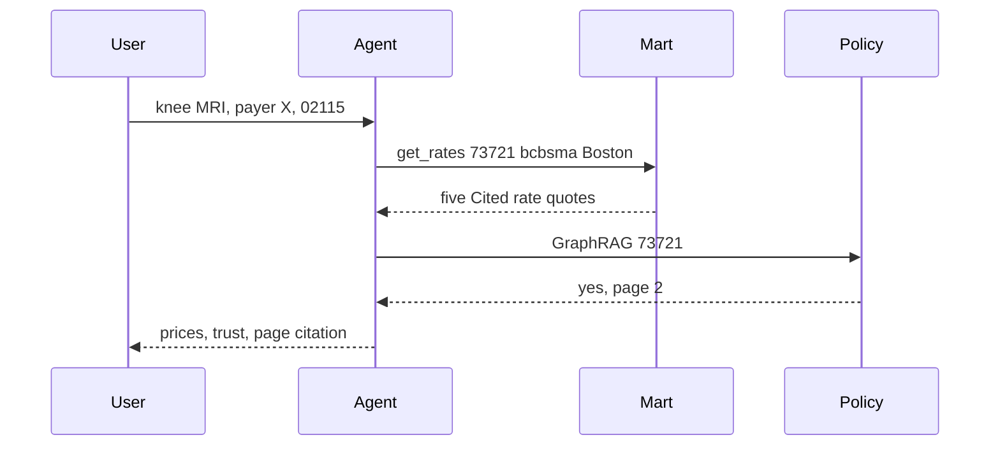

# CareTrace

CareTrace closes the loop between a healthcare price estimate and the bill that shows up later.

   

Demo GIF: `docs/demo.gif` (record after the Streamlit walkthrough in `docs/DEMO_SCRIPT.md`).

## The problem in 60 seconds

Priya needs a knee MRI. The hospital price files disagree, one directory listing is a ghost, and the explanation of benefits (EOB) does not match the rate the hospital published.

CareTrace answers four questions:

1. What did each hospital publish for this code and payer?
2. Is the provider listing actually in network?
3. Does the payer's policy say prior authorization is required, and on which page?
4. Does the bill match the published rate, and what would a draft dispute say?

Estimates are not quotes. Appeal letters are drafts. This is not legal or medical advice.

## What happens when you ask CareTrace

Ask: `knee MRI with payer X near 02115`.

How it works: the router treats "payer X" as Blue Cross Blue Shield of Massachusetts (`bcbsma`) and ZIP 02115 as Boston. It looks up CPT `73721` (the code only; the plain label "Knee MRI" was written for this project, not copied from an AMA descriptor). It loads published dollar rates, a directory score, and the sample imaging policy, then the verifier checks that every number in the sentence also appears in a tool result.

On the sample files the cited outpatient negotiated dollars are:

| Hospital | Published dollar | Source |
| --- | ---: | --- |
| Boston Medical Center | 980 | `data/samples/bmc_mrf.json` |
| Brigham and Women's Hospital | 1100 | `data/samples/bwh_mrf_tall.csv` |
| Tufts Medical Center | 1250 | `data/samples/tufts_mrf.json` |
| Massachusetts General Hospital | 1400 | `data/samples/mgh_mrf.json` |
| Beth Israel Deaconess Medical Center | 1750 | `data/samples/bidmc_mrf_wide.csv` |

Each quote includes `source_row_hash` and `ingested_at`. Priya Shah (NPI `1234567893`) scores as in network. The sample policy's code table on page 2 says `73721 required`. A code the policy never names comes back `unknown`.



<details>
<summary>Technical deep dive</summary>

`caretrace/agent/graph.py` runs router, clarify, execute, synthesize, verifier. Price rows are tagged `[[q_1]]` through `[[q_5]]`. `caretrace/agent/verifier.py` removes a number that is not in the tool JSON. The interval model is not applied to these five rows because they already have a published dollar. An imputed interval is a separate object and is never labeled as the hospital's price. See `docs/HOW_IT_WORKS.md`.

</details>

## Architecture

Hospital files become Parquet, dbt cleans them, and the agent and the dashboard read the gold mart. An uploaded EOB takes the audit path.

```mermaid
flowchart LR
  sources[MRFs policies NPI]
  bronze[Bronze Parquet]
  silver[dbt silver]
  gold[Gold marts]
  graph[Kuzu graph]
  agent[LangGraph agent]
  ui[FastAPI and Streamlit]
  eob[EOB upload]
  audit[Audit and appeal]
  sources --> bronze --> silver --> gold --> graph --> agent --> ui
  eob --> audit --> ui
  gold --> audit
```

| Component | What it does | Tech | Why |
| --- | --- | --- | --- |
| Ingest | Find `cms-hpt.txt`, stream the file, skip an unchanged hash | httpx, ijson, DuckDB manifest | MRFs do not fit in `json.load` |
| Transform | Type, dedupe, resolve payers, score quality | dbt-duckdb, Parquet | Same SQL can target Snowflake or Databricks |
| Serve | Cited rates and a transparency score | DuckDB `gold` schema | The API should not wait on a warehouse |
| Graph | Cheapest in-network path with edge lineage | Kuzu | The relationship is the evidence |
| Policies | Page-cited prior auth, or unknown | BM25, rank fusion, code-table hop | A pointer page is not the rule |
| Audit | Seven rules plus an "ask" anomaly tier | Pydantic findings | Rules stay reviewable |
| Agent | One question if a slot is missing, then a verifier | LangGraph, mock LLM by default | Numbers come from tools |
| App | Estimate, audit, chat, market, trust | FastAPI, Streamlit | Demo without a frontend build |

## Deep tech, explained

### Entity resolution

Analogy: two nicknames for the same insurer should land on one id, and a different plan should not.

What it does: links raw payer strings to `bcbsma`, `harvard-pilgrim`, or `tufts-health`, and can link provider strings the same way.

<details>
<summary>Technical deep dive</summary>

Fellegi-Sunter: for each comparison, agreement has probability `m` if the pair is a match and `u` if it is not. The match weight is `log2(m/u)` on agreement and `log2((1-m)/(1-u))` on disagreement. Expectation maximization fits `m`, `u`, and the prior. A plan-token Jaccard under 0.2 blocks the pair. Code: `caretrace/er/linkage.py`. On `eval/datasets/er_labels.csv` (300 pairs) F1 is 1.000 versus 0.667 for rapidfuzz at a score of 90.

</details>

### Knowledge graph

Analogy: a price is an edge, not a cell in a spreadsheet.

What it does: answers "cheapest in-network option" by walking provider, hospital, plan, and negotiated rate.

<details>
<summary>Technical deep dive</summary>

Cypher is `CHEAPEST_CYPHER` in `caretrace/graph/queries.py`. Negotiated edges store `source_row_hash`, `source_file_uri`, and `ingested_at`. The graph file is rebuilt from the gold mart and is safe to delete.

</details>

### Conformal price intervals

Analogy: when the hospital did not publish a dollar, draw a range that is honest about being a guess.

What it does: predicts a point and a low/high band, always marked `imputed`.

<details>
<summary>Technical deep dive</summary>

Three quantile regressors (0.1, 0.5, 0.9) on log price, then split conformal slack, with a separate slack per code family (Mondrian). The finite-sample level is `ceil((n+1) * 0.90) / n`. Code: `caretrace/ml/price_model.py`. On a synthetic process, holdout coverage was 0.957. `explain()` lists the features that moved the point. These intervals are not in the price cards for published dollars.

</details>

### Directory trust

Analogy: a phone number that matches is not proof the clinic exists.

What it does: scores a listing and says ghost risk in plain language.

<details>
<summary>Technical deep dive</summary>

Hand weights are in `caretrace/directory/trust.py`. The learned model is an additive binner plus isotonic calibration in `trust_model.py`. On `scripts/inject_ghosts.py` output, model AUC is 1.000 and a phone-heavy baseline is 0.000, because the synthetic ghosts were given a matching phone on purpose. A reliability diagram is written to `eval/reliability.png`.

</details>

### GraphRAG

Analogy: the first page says "see the other policy." The answer has to follow that pointer.

What it does: maps a code to the policy section that states the requirement, then checks the claim against that text.

<details>
<summary>Technical deep dive</summary>

`caretrace/policy/graphrag.py` reads lines like `73721 required`. Entailment is the share of claim words present in the chunk, threshold 0.6. If the code is absent, `requires_pa` is `unknown`. Eval: accuracy 1.000, unknown rate 0.333, page accuracy 1.000 on 30 labeled questions.

</details>

### Anomaly explanations

Analogy: rules catch the mistakes you already named. A strange ratio is a question, not a verdict.

What it does: flags a line whose allowed amount, units, or code pair looks unlike the synthetic claims, and says what would have kept it quiet.

<details>
<summary>Technical deep dive</summary>

`caretrace/audit/anomaly.py` blends Isolation Forest with an ECOD-style tail score. Severity is `ask`. Those findings are left out of the appeal total. `explain()` returns feature notes and a counterfactual allowed amount.

</details>

### Verifier

Analogy: if the sentence contains a dollar the tools never returned, delete the sentence.

What it does: keeps the demo from shipping a made-up number.

<details>
<summary>Technical deep dive</summary>

`uncited_numbers` compares digit runs in the answer with the tool JSON. On five demo prompts the uncited rate is 0.000. An injected `$99999` is removed. Policy text that says "ignore previous instructions" is not used as evidence.

</details>

### Privacy and streaming

Analogy: a market chart for an employer should not point at one employee, and a giant JSON file should not be loaded whole.

What it does: suppresses small cells, adds noise, and streams a Transparency-in-Coverage shaped file.

<details>
<summary>Technical deep dive</summary>

Laplace histogram median, epsilon tracked by `PrivacyAccountant`, k of 11. Local stream benchmark: 0.324 MB, 400 rows kept, about 51 MB/s. Details in `docs/SCALE.md`. This is not a cluster cost number.

</details>

## Why should you trust an answer?

A rate on screen has a file, a hash, and a time. Confidence is the row's quality score, with reasons such as "percent only" or "algorithm only." The verifier abstains on a number it cannot bind. Prior auth abstains when the policy never mentions the code. View source in the Estimate page is the same lineage object the API returns.

Screenshot placeholder: `docs/view-source.png`.

## Results

From `eval/report.md`, generated by `make eval` on the samples and the mock model. Cost per query is $0.

| Metric | Baseline | CareTrace |
| --- | ---: | ---: |
| Price exact-match (50 questions) | — | 1.000 |
| Citation present on every quote | — | 1.000 |
| Prior-auth accuracy (30 questions) | narrative match without a code check | 1.000 |
| Prior-auth unknown rate | — | 0.333 |
| Citation page accuracy | — | 1.000 |
| EOB field F1 (30 PDFs) | — | 1.000 |
| Audit precision / recall | — | 1.000 / 1.000 |
| Dollar impact MAE | — | 0.00 |
| Answers with an uncited number | — | 0.000 |
| Payer-pair F1 | rapidfuzz 0.667 | Fellegi-Sunter 1.000 |
| Ghost-listing AUC | phone-weighted 0.000 | additive model 1.000 |
| Interval coverage (synthetic) | nominal 0.90 | 0.957 |

Takeaway: on these samples the published knee-MRI dollars come back with a row hash, the policy cites page 2 or says unknown, and the injected bill errors match the answer key. The interval coverage is on a fake price process, not on held-out hospital files.

## Quickstart

No API key. The mock model is the default.

```bash
uv sync --extra dev
cp .env.example .env
uv run caretrace load-samples
uv run caretrace chat "knee MRI with payer X near 02115"
uv run python -m eval.run
```

Full setup:

```bash
make check
make dbt
make api    # http://localhost:8000/docs
make ui     # http://localhost:8501
```

`make check` is ruff, mypy, and pytest. Coverage must stay at or above 80 percent.

## Repo map

```text
caretrace/     Python package: ingest, parse, audit, agent, API
dbt/           Staging, silver, gold, OMOP views, seeds
ui/            Streamlit demo
data/samples/  Tiny MRFs, one FHIR bundle, one policy, synthetic EOBs
eval/          Questions, report, results
config/        Hospital and payer registry
docs/          Architecture, decisions, dashboard, scale, demo
scripts/       Synthea notes, code-ref fetch, BI export, ghost injection
```

## Data, limits, ethics

Sources, including the verified `cms-hpt.txt` hosts, are described in `docs/DATA_SOURCES.md`.

Limits: five sample hospitals, three payers, one imaging policy, and synthetic bills. Unbundling pairs are illustrative, not the CMS National Correct Coding Initiative table. Directory data is a mock, with an NPPES client that is unused until you call it. Conformal coverage was measured on a simulated price process.

CPT: store the code, never an AMA descriptor. HCPCS Level II and MS-DRG text in the seeds comes from CMS public files.

Do not upload a real EOB. Demo mode rejects Social Security number patterns. See `SECURITY.md`.

## Roadmap

The five Boston machine-readable files are parsed; see `docs/DATA_SOURCES.md`. Swap the mock model for Groq when you want a live narrative. Point dbt at Snowflake or Databricks with the extra profiles. Replace the lexical entailment check with a cross-encoder if you need graded faithfulness.

## Interview talking points

- A published price and an imputed interval are different objects, and the UI is not allowed to blur them.
- Payer resolution fails in a specific way: same name, different plan. The plan block exists for that case.
- The appeal template owns the numbers. The model only writes a paragraph, and digits are stripped from that paragraph.
- The verifier is a test, not a prompt. An injected dollar that is not in the tool JSON is removed.
- Small cells are hidden (k of 11) before any employer chart is drawn, and epsilon is an explicit spend.

## Glossary

| Term | Meaning |
| --- | --- |
| MRF | Machine-readable file. The hospital price list CMS requires, plus a `cms-hpt.txt` index at the site root. |
| NPI | National Provider Identifier, from the NPPES registry. |
| EOB | Explanation of benefits. The payer's statement of what it allowed and what the patient owes. |
| CPT | A procedure code set published by the AMA. This repo stores codes only. |
| HCPCS | Healthcare Common Procedure Coding System. Level II descriptions from CMS are allowed here. |
| DRG | Diagnosis-related group. A hospital stay category. MS-DRG descriptions from CMS are allowed here. |
| OMOP | A common data model for clinical records. The demo maps a synthetic FHIR bundle into a small subset. |
| FHIR | A health data API standard. The sample patient is a FHIR R4 bundle. |
| Prior authorization | A payer's requirement to approve a service before it happens. |
| Conformal prediction | A way to widen a model's interval so that, under exchangeability, the true value falls inside at a chosen rate. |
| SHAP | A method that assigns a prediction's change to each input. The price model uses a local permutation explanation in that role. The optional `shap` package is not required. |
