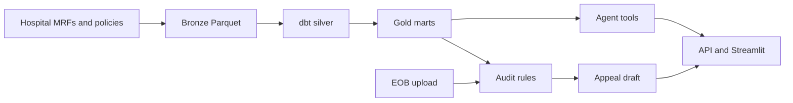

# Architecture

CareTrace closes the loop between a price estimate and the bill that arrives later. Six modules share one rule: a number shown to a person carries a source file, a row hash, a time, and a confidence.

## How it works

Hospital machine-readable files (MRFs) land in Parquet. dbt types them and resolves payers. A DuckDB gold mart serves prices. A separate path turns a synthetic explanation of benefits (EOB) into findings and a draft letter. The agent calls both paths and a verifier drops any number the tools did not return.

## Modules

| Module | Plain description | Code |
| --- | --- | --- |
| Price lakehouse | Read hospital price files without loading them whole, then publish a rate per hospital, code, setting, payer, and plan. | `caretrace/parse`, `caretrace/warehouse.py`, `dbt/` |
| Directory trust | Score a provider listing against NPI, address, and whether that payer shows up in the hospital file. | `caretrace/directory` |
| Prior-auth policies | Answer from policy text, with a page number, or say unknown. | `caretrace/policy` |
| Bill audit | Compare a synthetic EOB with the published rate and draft a letter. | `caretrace/audit` |
| Agent | Route the question, call tools, cite, and strip uncited numbers. | `caretrace/agent` |
| App | HTTP API and a Streamlit demo. | `caretrace/api`, `ui/app.py` |

## Lineage

`caretrace/models/lineage.py` defines `Lineage` and `Cited`. `row_hash` is the SHA-256 of canonical JSON, so key order does not change the hash. Derived numbers add `method` and `parameters`.
