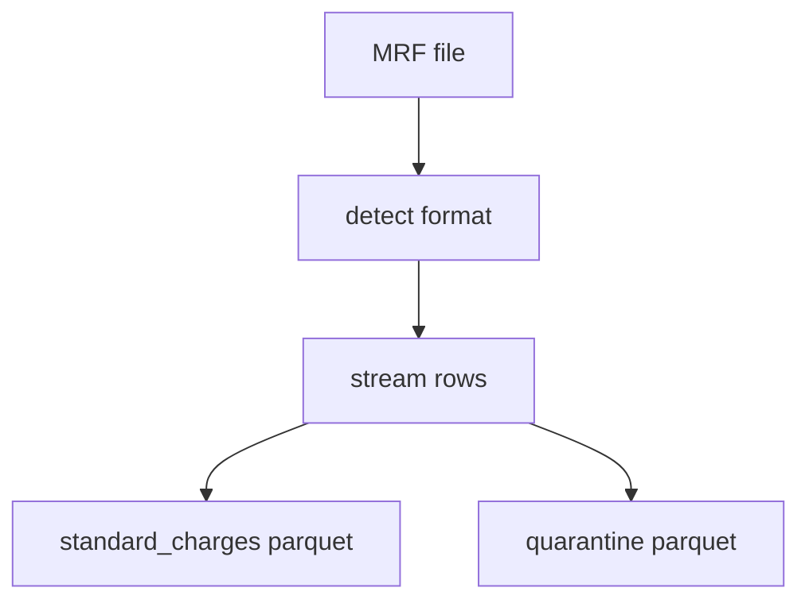
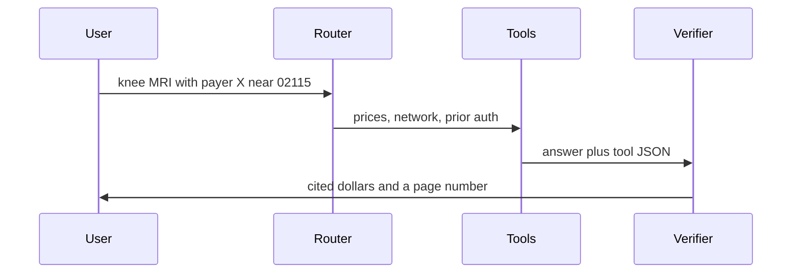

# How CareTrace works

This is the long form of the README. Each section is one module.

## Price files

A hospital MRF can be a large JSON or a wide CSV. `caretrace/parse/detect.py` looks at the first bytes. JSON v2 is streamed with `ijson` over `standard_charge_information`. CSV uses Polars lazy scans and batches. Rows that fail validation go to `data/bronze/_quarantine` with a reason. Accepted rows go to `standard_charges`, partitioned by `source_id`.

## Payers and entities

Raw payer strings are normalized (strip "inc", "plan", punctuation) and matched with rapidfuzz. At or above 90 the payer id is automatic. From 75 to 90 the row waits in a review band. Under 75 it stays unknown. `caretrace payers confirm` appends a row to `dbt/seeds/payer_confirmations.csv`.

The Fellegi-Sunter linker is a second opinion for pairs. It compares names and plan tokens and writes a match probability. `explain(pair)` lists the match weight of each comparison.

## Gold rates

`mart_negotiated_rates` keeps one row per hospital, code, setting, payer, and plan. `quality_score` starts at 1 and loses 0.35 when there is no dollar, 0.15 when the cell is percent-only, 0.25 when it is algorithm-only, and 0.25 when the dollar is an outlier (above Q3 + 3×IQR, with at least 4 peers). `get_rates` returns `Cited[RateQuote]`. Confidence is that quality score.

Out-of-pocket math in `caretrace/audit/estimate.py` applies copay, then remaining deductible, then coinsurance, and stops at the remaining out-of-pocket maximum. A $1000 allowed amount, $200 deductible, 20% coinsurance, and a $50 copay is $400 to the patient when the out-of-pocket maximum is not reached.

## Graph

`caretrace/graph/build_graph.py` loads hospitals, plans, negotiated rates, and the mock providers into Kuzu. `cheapest_in_network` returns the lowest rate whose provider is affiliated with the hospital and in network for the plan with trust at least 0.5, plus the edge path.

## Directory

Signals and weights: NPI active 0.20, name 0.20, address 0.20, taxonomy 0.15, phone 0.10, recency 0.05, MRF corroboration 0.10. An inactive NPI forces `ghost_risk` even when the other signals look fine. The learned model in `trust_model.py` is an additive binner with isotonic calibration. On a synthetic set where phone match is a decoy, that model AUC is 1.000 and the phone-heavy baseline AUC is 0.000.

## Policies

Chunks keep page numbers. Retrieval is BM25 plus a hashing embedder, fused with reciprocal rank fusion. GraphRAG prefers a code-table hop. A claim whose words are not in the cited chunk is dropped. A code the policy never mentions returns `unknown`.

## Audit and letter

Rules live in `caretrace/audit/rules/builtin.py`.

| Rule | What it catches |
| --- | --- |
| R1 | Allowed amount above the published negotiated dollar, plus a tolerance of $1 or 1%. |
| R2 | Same code, date, units, and provider on two lines. |
| R3 | Both codes of an illustrative bundled pair. The seed is not the CMS NCCI table. |
| R4 | E/M level that looks high for the visit. Low severity. |
| R5 | Bill says out of network while directory confidence is at least 0.8. |
| R6 | Discounted cash price is below the patient's responsibility. |
| R7 | A prior-auth denial when the policy says prior auth is not required. |

The letter templates insert every number. The language model is asked for a paragraph and digits are stripped from that paragraph.

## Agent

`payer X` maps to `bcbsma`. ZIP `02115` maps to Boston. One missing slot produces one question, not a stack of them.

## API and UI

`caretrace/api/main.py` exposes chat, prices, trust, prior auth, audit, and appeal. Demo mode rejects SSN-shaped strings on JSON bodies. Multipart uploads are checked after text extraction so PDF bytes are not scanned as identifiers. Streamlit calls that API.
